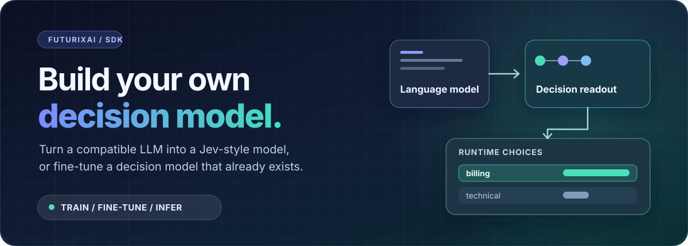

# Decision SDK




### Build your own Jev-style decision model.

**Train. Fine-tune. Infer.** Turn a compatible open text LLM into a decision
model, or continue training a released decision checkpoint on **your decision
data**. Ask it to choose among your candidates instead of generating a
free-form answer. One SDK spans dataset loading, decision SFT, calibration,
RLCD, export, and inference.

> **Source release:** The SDK and installable package are in this repository;
> model weights are downloaded separately when needed. “Jev-style” describes
> the typed-decision workflow, not guaranteed parity with Jev or any
> publisher's model.

## Make it yours

**01 · Train a new decision model** — choose a pointer, Bosun-style token,
or letter-code readout for a compatible LM; fit it on labeled decisions.

**02 · Fine-tune a decision model** — adapt supported Bosun, Laya, Clef, Kev
and other native releases while preserving their own readouts.

**03 · Infer and deploy** — run `choice`, `noul` (yes/no), and `score`;
batch, evaluate, export, or serve through supported backends.

Install the training extra from a clone with
`python -m pip install -e ".[train]"`. Save a labeled row as
`decisions.jsonl`:

```json
{"id":"ticket-1","kind":"choice","state":"Customer was charged twice","question":"Which team?","options":["billing","technical"],"target":"billing"}
```

```python
from futurix_decision import DecisionTrainer, SFTConfig, load_model

# A plain LLM becomes a trainable decision model; it is not trained yet.
model = load_model("HuggingFaceTB/SmolLM2-135M", convert=True, strategy="pointer")
trainer = DecisionTrainer(
    model=model,
    dataset="decisions.jsonl",
    sft_config=SFTConfig(method="full"),  # trains the pointer head by default
)
trainer.train(stages=["decision_sft"])
trainer.export("./my-decision-model")

result = load_model("./my-decision-model").choice(
    state="A customer was charged twice",
    choices=["billing", "technical"],
)
print(result.decision, result.probabilities)
```

This quickstart updates the **pointer head**; to train the backbone too, set
`train_backbone=True` when converting or use LoRA. For reliable confidence,
calibrate on separate held-out data; one demo row cannot establish quality.

Already have a decision model? Continue its **native** readout instead:

```python
released = load_model("laya")  # install .[laya] for this model
tuned = released.finetune("decisions.jsonl", "./my-laya")
print(tuned.choice(state="Customer was charged twice", choices=["billing", "technical"]).decision)
```

[Getting started](docs/getting-started.md) ·
[Bring your own data](docs/datasets-and-training.md).

## Supported decision models

| Released decision model | SDK inference | Train on your dataset | Fine-tune release | vLLM decisions |
|:--|:--:|:--:|:--:|:--:|
| [Bosun v3.1 0.6B](https://huggingface.co/Hanno-Labs/bosun-v3.1-0.6b) / [1.7B](https://huggingface.co/Hanno-Labs/bosun-v3.1-1.7b) | ✅ | ✅ SFT / RLCD | ✅ | ✅ export |
| [Laya](https://huggingface.co/convaiinnovations/laya) / [Multilingual](https://huggingface.co/convaiinnovations/laya-multilingual) | ✅ | ✅ native | ✅ | — |
| [Kev 9B](https://huggingface.co/jaredpalmer/kev-9b) | ✅ | ✅ native | ✅ | — |
| [Clef](https://huggingface.co/Cloudflare/clef) / [Clef-Flash](https://huggingface.co/Cloudflare/clef-flash) | ✅ | ✅ native | ✅ | — |
| [GLiNER2.5-Decide](https://huggingface.co/fastino/GLiNER2.5-Decide) | ✅ | ✅ hard labels | ✅ | — |
| [Perplexity Decider 27B](https://huggingface.co/perplexity-ai/pplx-decider-v1.1-27b) | ✅ | ✅ native | ✅ | — |
| [Decider 4B](https://huggingface.co/Mapika/decider-4b) | ✅ | ✅ SFT / RLCD | ✅ | 🧪 export |
| [JPT 4B](https://huggingface.co/kirp/jpt-4b) / [9B](https://huggingface.co/kirp/jpt-9b) | ✅ text | ✅ SFT / RLCD | ✅ | 🧪 export |
| [Eikos 4B](https://huggingface.co/caiovicentino1/Eikos-4B) / [27B](https://huggingface.co/caiovicentino1/Eikos-27B) | ✅ text | ✅ SFT / RLCD | ✅ | 🧪 export |
| Nox [1.0](https://huggingface.co/vllm-sr/Decision-1.0-Nox-4B) / [2.0](https://huggingface.co/vllm-sr/Decision-2.0-Nox-4B) | ✅ | — | — | — |
| Lux [1.0](https://huggingface.co/vllm-sr/Decision-1.0-Lux-9B) / [2.0](https://huggingface.co/vllm-sr/Decision-2.0-Lux-9B) | ✅ | — | — | — |
| [Liquid d1 3B](https://huggingface.co/LiquidAI/d1-3B) | ✅ | — | — | — |
| [OpenJev](https://huggingface.co/openjev/openjev) / [Flash 9B](https://huggingface.co/openjev/OpenJev-Flash-9B) | ✅ server | — | — | ↗ helper |

“Train” means an SDK path for training **on labeled decision data**, not
pretraining a publisher architecture from scratch. A checkmark is
model-specific: some paths need publisher packages, pinned remote code,
substantial GPU memory, or hard labels. OpenJev requires its running
publisher server; Nox, Lux, and d1 remain inference-only here.
[See requirements and limits](docs/model-support.md).

**vLLM legend:** ✅ export = decision-aware SDK inference from an exported
checkpoint; 🧪 export = adapter/fixture path implemented, **not** verified
for numerical parity on the published weights; ↗ helper = the publisher's
separate vLLM-backed server; — = no SDK vLLM decision adapter. `vllm-sr`
in a repo name does not mean `VLLMEngine` can serve its decision head.
[Backend requirements and examples](docs/inference-backends.md).

## Convert an LLM into a decision model

```python
from futurix_decision import load_model

pointer = load_model("your-org/text-causal-lm", convert=True, strategy="pointer")
bosun_style = load_model("your-org/text-causal-lm", convert=True, strategy="bosun")
letter_code = load_model(
    "your-org/text-causal-lm",
    convert=True,
    strategy="letter_code",
    decision_tokens=8,
)
```

- **Pointer** (default): candidate-aware head, 2–256 choices, no new tokens.
  Head-only SFT by default; opt into full-backbone SFT or LoRA/QLoRA.
- **Bosun-style**: 256 fresh decision tokens and stable prompt slots,
  2–255 supplied choices. Full SFT or LoRA; add token rows **before** QLoRA.
- **Letter-code**: separate readout initialized from existing single-token
  letter codes, up to 255 choices **if the tokenizer supports that many**.
  Full SFT or LoRA; no new vocabulary rows. Does not import Decider weights.

Each path needs labeled decision SFT; calibration and RLCD can follow.
Conversion is **not** native-model fine-tuning or instant Jev/Bosun quality.

| Raw LLM checkpoint | Variant | Pointer | Bosun | Letter-code |
|:--|:--|:--:|:--:|:--:|
| [SmolLM2-135M](https://huggingface.co/HuggingFaceTB/SmolLM2-135M) | Base | C | C | C |
| [SmolLM2-1.7B-Instruct](https://huggingface.co/HuggingFaceTB/SmolLM2-1.7B-Instruct) | Chat | C | C | C |
| [Qwen3-0.6B](https://huggingface.co/Qwen/Qwen3-0.6B) / [1.7B](https://huggingface.co/Qwen/Qwen3-1.7B) | Base | C | C | C |
| [Qwen3-4B-Instruct-2507](https://huggingface.co/Qwen/Qwen3-4B-Instruct-2507) | Non-thinking chat | C | C | C |
| [Qwen3-4B-Thinking-2507](https://huggingface.co/Qwen/Qwen3-4B-Thinking-2507) | Thinking | C | C | C |
| [Qwen2.5-7B-Instruct](https://huggingface.co/Qwen/Qwen2.5-7B-Instruct) | Chat | C | C | C |
| [DeepSeek-R1-Distill-Qwen-7B](https://huggingface.co/deepseek-ai/DeepSeek-R1-Distill-Qwen-7B) | Thinking | C | C | C |
| [Mistral-7B-Instruct-v0.3](https://huggingface.co/mistralai/Mistral-7B-Instruct-v0.3) | Chat | C | C | C |
| [Phi-4-mini-instruct](https://huggingface.co/microsoft/Phi-4-mini-instruct) | Chat | C | C | C |
| [OLMo-2-1124-7B-Instruct](https://huggingface.co/allenai/OLMo-2-1124-7B-Instruct) | Chat | C | C | C |
| [gpt-oss-20b](https://huggingface.co/openai/gpt-oss-20b) | Thinking | C | C | C |
| [Qwen3.5-9B](https://huggingface.co/Qwen/Qwen3.5-9B) / [9B-Base](https://huggingface.co/Qwen/Qwen3.5-9B-Base) | Hybrid; text decisions | S | S | S |
| [Qwen3.8-27B](https://huggingface.co/Qwen/Qwen3.8-27B) | Hybrid; text decisions | — | — | S |

**C** = architecture-level candidate, **not** released-weight conversion or
training verification; letter-code also needs suitable single-token codes.
**S** = explicit SDK route tested only with small synthetic or mocked models;
**—** = rejected by the current route. Chat/thinking prompts, tokenizer,
memory and export must be checked per checkpoint. Encoder-only, seq2seq,
and arbitrary multimodal LMs are not generic conversion targets.
[Strategy details and checkpoint-by-checkpoint compatibility](docs/conversion.md).

[Quickstart](docs/getting-started.md) ·
[Training guide](docs/datasets-and-training.md) ·
[Model requirements](docs/model-support.md) ·
[Inference backends](docs/inference-backends.md)

<details>
<summary><strong>Open full technical reference</strong> · datasets, architectures, experiments, CLI and API</summary>

## Installation

Requires Python 3.10+. The base install is torch-free: schemas, dataset
loading, metrics, and HTTP runtimes. Local models need PyTorch through the
`torch` extra, which every model, `train`, `serve`, and `vllm` extra includes.
From the repository root:

```bash
python -m pip install -e .            # core, no torch
python -m pip install -e ".[torch]"   # local models
python -m pip install -e ".[datasets,train,serve,dev]"
# Optional, on supported NVIDIA GPUs:
python -m pip install -e ".[qlora,vllm]"
python -m unittest discover -s tests -v
```

Use the appropriate PyTorch wheel for your CUDA installation. W&B logging is
optional (`.[wandb]`); no proprietary service is needed.

## Canonical data

Every training/evaluation record has `id`, `kind` (`choice`, `noul`, or `score`),
`state` (JSON object or text), `question`, ordered `options`, and `target`
(candidate label/index or a probability distribution in options order):

```python
from futurix_decision.datasets import load_decisions

dataset = load_decisions(
    {
        "id": "procurement-001",
        "kind": "choice",
        "state": {"gst_certificate": "expired", "budget": "approved"},
        "question": "What should happen next?",
        "options": ["approve", "request_document", "reject", "escalate"],
        "target": [0.02, 0.78, 0.05, 0.15],
    }
)
assert dataset[0].target_distribution() == [0.02, 0.78, 0.05, 0.15]
```

`load_decisions` accepts a row, an iterable of rows, local `.json` / `.jsonl`
files, or a Hugging Face dataset ID (with the `datasets` extra). Set
`streaming=True` for a lazy iterator; use `split="calibration"` or another
split when appropriate. Common aliases (`choices`, `candidates`, `label`,
`answer`, `probabilities`, `query`, `context`) are normalized. Invalid targets
are rejected, never silently renormalized. `noul` uses `["false", "true"]`;
`score` requires consecutive integer levels (default 0–5).

JSONL/Hugging Face rows such as `{"state": "...", "question": "...",
"options": ["yes", "no"], "label": "yes"}` are the default interchange.
There is **no single universal decision-dataset column standard**. For
multi-question decisions use one System One record per line with `state`,
typed `questions`, and `targets` (also accepts `expected` or `gold`) keyed
by question ID:

```json
{"id":"ticket-7","state":"Card charged twice","questions":{"route":{"type":"choice","instructions":"Which team?","criteria":{"billing":"Refunds","support":"Other"}},"urgent":{"type":"noul","instructions":"Is this urgent?"}},"targets":{"route":{"probabilities":{"billing":0.9,"support":0.1}},"urgent":false}}
```

`load_decisions` expands these into validated examples, preserving the shared
`group_id`, `question_id`, options, descriptions and soft targets. Training
and evaluation also accept these rows in memory. A label or distribution is
required for **every** question; arbitrary unlabeled text does not become a
decision dataset just because it is in JSONL. Conversation states can be a
JSON list; structured publisher questions remain available as
`example.native_question`. Optional `images` file paths or data URLs are
retained for Clef/PPLX native training and Clef/PPLX/d1 inference; text-only
trainers reject them. Video and generic media rows require an explicit
model-specific adapter. Keep held-out evaluation and calibration rows separate.

The included public dataset adapter uses the actual
[`SargeDev/jev-distill-corpus-v3`](https://huggingface.co/datasets/SargeDev/jev-distill-corpus-v3)
schema:

```python
from futurix_decision.datasets import load_open_decisions

dataset = load_open_decisions()  # streaming train split; 655,806 rows
example = next(dataset)
```

For an independent held-out evaluation, use `split="test_set_30k"` rather than
the train, validation, or calibration splits. Credit the dataset's creators if
you use it; the corpus is Apache-2.0 licensed and is not bundled in this wheel.

## Importing existing decision checkpoints

Use an explicit native loader. `DecisionModel.from_pretrained` is for plain
LLMs and Futurix exports; it now rejects recognized third-party decision
checkpoints so their trained prompts and readouts cannot be silently replaced.

Bosun v3.1 uses `DecisionModel.from_bosun(...)` (see below). The first new
native importer is `Mapika/decider-4b` **v2.1** for text/JSON inputs:

```bash
python -m pip install -e ".[decider]"
futurix-decision evaluate --model Mapika/decider-4b --model-format decider \
  --dataset decisions.jsonl
futurix-decision train --model Mapika/decider-4b --model-format decider \
  --dataset decisions.jsonl --calibration-dataset heldout.jsonl \
  --stages decision_sft,calibration,rlcd --finetune-method lora \
  --output ./decider-futurix
```

```python
from futurix_decision import DecisionModel, DecisionTrainer, SFTConfig

model = DecisionModel.from_decider("Mapika/decider-4b")
result = model.choice(state="Review this ticket", choices=["approve", "reject"])
trainer = DecisionTrainer(
    model=model,
    dataset="decisions.jsonl",
    sft_config=SFTConfig(method="lora"),
)
trainer.train(stages=["decision_sft"])
trainer.export("./decider-futurix")
restored = DecisionModel.from_pretrained("./decider-futurix")
```

This importer keeps the upstream existing A–Z/AA–... vocabulary rows,
plain prompt, v2.1 type-specific temperatures and independent yes/no rows
for each Score level. It does not create new decision tokens or a new head.
There are at most 255 Choice options and ten Score levels. SDK `score()`
returns the most likely level (and its full probability map), whereas the
publisher's Jev-shaped API returns the distribution's expected level.
The native checkpoint requires Transformers 5.17+; the separate `bosun`
extra pins Transformers 4.x, so run those integrations in separate Python
environments. A 4B training run needs suitable GPU memory; unit tests use
tiny local models rather than the published 4B weights.

After exporting a complete Futurix checkpoint, `VLLMEngine("./decider-futurix")`
or `futurix-decision evaluate --backend vllm --model ./decider-futurix`
performs one restricted-logprob prefill per row (or per isolated Score
level). Install `.[decider-vllm]` and use a vLLM build that supports Qwen3.5.
Bare `vllm serve Mapika/decider-4b` does not expose the SDK's typed
decisions. Native-model/vLLM numerical parity has not yet been verified
on the published 4B checkpoint.

Text-only importers also exist for `kirp/jpt-4b`, `kirp/jpt-9b` and
`caiovicentino1/Eikos-4B`/`Eikos-27B`:

```bash
python -m pip install -e ".[jpt]"   # or .[eikos], in a Transformers 5 environment
futurix-decision train --model kirp/jpt-4b --model-format jpt \
  --dataset decisions.jsonl --output ./jpt-futurix --finetune-method lora
futurix-decision evaluate --model caiovicentino1/Eikos-4B \
  --model-format eikos --dataset decisions.jsonl
```

`DecisionModel.from_jpt(...)` uses llm2jev's contextual label-token check,
chat template with thinking disabled and JPT's held-out temperature.
`DecisionModel.from_eikos(...)` uses SemIf's JSON prompt, its published
one-token label table and checks the release's T=1 calibration. Both
preserve their trained LM rows, use the SDK's differentiable decision
losses for *new* SFT/LoRA/RLCD fine-tuning, and export reloadable models.
JPT supports up to 255 options; the Eikos one-pass limits are 100 (4B) and
160 (27B). Above those Eikos limits the publisher uses a tournament, which
this SDK does not implement. Both original JPT weights are
**CC BY-NC 4.0**. JPT requires Transformers 5.17+; Eikos requires 5.12+.
Their released vision/image paths are **not** supported by these canonical
text/JSON `DecisionInput` adapters. The JPT/Eikos vLLM paths operate on
Futurix-exported checkpoints using restricted first-token logprobs; use
`.[jpt-vllm]` or `.[eikos-vllm]` and compatible vLLM releases. No full
publisher-weight GPU parity or published-benchmark tests have been run.
All three native letter importers reject `noul` inputs whose answer IDs
cannot be unambiguously identified as the literal `true` and `false`;
they must not guess the meaning of opaque benchmark IDs. If exporting an
unmerged PEFT adapter for continued training, reload it with
`DecisionModel.from_pretrained(path, trainable_adapter=True)`.

The legacy `DecisionModel.from_pretrained` path above still rejects these
publisher checkpoints. The selected native integrations below use
`load_model` instead, preserving each publisher's own decision readout.
Loading an LM backbone in vLLM is not equivalent to serving its trained
decision readout. JPT-35B-A3B is catalogued for fail-closed loading but
does not have a verified importer.

## Selected native decision models

`load_model` offers `choice`, `noul`, `score`, `decide`, `batch_decide` and
`system_one` over supported native variants. `model.runtime` remains
available for publisher-specific hooks and APIs; `model.capabilities`
reports whether a native training/export recipe is implemented.

```python
from futurix_decision import load_model

model = load_model("laya")  # convaiinnovations/laya; pip install -e ".[laya]"
result = model.choice(
    state="The customer was charged twice",
    question="Who should handle this?",
    choices=["billing", "shipping"],
)
print(result.decision, result.probabilities)
trained = model.finetune("train.jsonl", "./my-laya")
assert trained.choice(state="Card charged twice", choices=["billing", "shipping"])
```

### Loading from Hugging Face or disk

Pass a supported Hub ID or alias to `load_model(...)`: the publisher loader
downloads missing files into the normal Hugging Face cache and reuses cached
files on later calls. Pass an existing directory (a `Path`, absolute path,
or `./relative/path`) to load its checkpoint from disk. A publisher copy
can be recognized by its native config/head even if renamed; for an
ambiguous local variant, specify `family=...` explicitly.

```python
from pathlib import Path
from futurix_decision import load_model

# Downloads on first use; remote publisher code needs a reviewed pinned commit.
release = load_model(
    "clef-flash", revision="<40-character-commit>", trust_remote_code=True, device="cuda"
)
# No Hub download for the local checkpoint itself (referenced base models may
# still need to be cached or downloaded, e.g. Bosun and Kev).
on_disk = load_model(
    Path("/models/my-clef-variant"), family="clef", trust_remote_code=True, device="cuda"
)
```

The SDK checks required configs, trained heads/readouts and every weight shard
listed in a safetensors index before loading a local checkpoint or a
Clef/PPLX/Nox/Lux/d1 Hub snapshot. Missing components raise `FileNotFoundError` with the family,
source and filenames; missing local paths are never interpreted as Hub IDs.
Kev's Hub pointer head is checked before its base is loaded. Other publisher
loaders also validate their own artifacts. An incomplete directory cannot
silently become an untrained generic LM. SDK-exported Futurix checkpoints
can likewise load from disk or from a Hub repo containing
`decision_config.json`. OpenJev is the exception: it requires its published
HTTP/vLLM helper rather than direct SDK loading of a weights directory.

The same `load_model(...)` entry point accepts Bosun's **typed-decision**
releases: `bosun-0.6b` (`Hanno-Labs/bosun-v3.1-0.6b`) and `bosun-1.7b`
(`Hanno-Labs/bosun-v3.1-1.7b`). It pins each repository to its verified
commit and keeps Bosun's 256 trained decision-token rows and prompt contract.
Bosun-XS and Bosun-4B are binary rerankers, not these typed-decision releases.

The explicitly selected checkpoints and current limits:

- **Kev:** `jaredpalmer/kev-9b` local pointer-head load, inference and native
  LoRA/pointer-head fine-tuning via the publisher's `kev` package, saving
  `head.pt` and adapter together. Other Kev sizes are not verified.
- **Laya and Laya Multilingual:** `convaiinnovations/laya` and
  `convaiinnovations/laya-multilingual` load with `laya`; its native fine-tuner
  accepts our grouped soft targets, fits held-out temperatures and saves a
  reloadable encoder/head checkpoint.
- **Clef:** `Cloudflare/clef` and `Cloudflare/clef-flash` load their
  `joint_head.safetensors` with the publisher's pinned `joint_schema_model.py`.
  Native differentiable head-only (default) or full fine-tuning exports the
  backbone, processor, joint head, config and code together. Requires
  `trust_remote_code=True` and a **40-character pinned Hub revision**.
  `clef-omni` is not verified.
- **GLiNER:** `fastino/GLiNER2.5-Decide` loads a schema-aware encoder and
  trains/exports through `gliner2[train]`. Its native loss is hard-label
  classification: soft labels fail unless you explicitly set
  `target_policy="argmax"` (which discards their distribution).
- **Perplexity decider:** `perplexity-ai/pplx-decider-v1.1-27b` loads through
  the publisher's installed `autojev` source. Full-weight or readout-only
  fine-tuning keeps the checkpoint's noncausal attention and 255-code readout
  and saves via its native `save()`. Requires a pinned revision and adequate
  GPU memory; there is no generic vLLM decision exporter.
- **OpenJev:** `openjev/openjev` and `openjev/OpenJev-Flash-9B` infer through
  their publisher's **System One helper in front of vLLM**, not a bare vLLM
  chat endpoint. The SDK checks `/v1/version` for the requested model and
  release-specific calibration. Native fine-tuning is not implemented.
- **Nox and Lux:** aliases select `vllm-sr/Decision-2.0-Nox-4B` and
  `vllm-sr/Decision-2.0-Lux-9B`; explicit `Decision-1.0-*` IDs also load.
  These use the publisher's candidate head through pinned Transformers
  remote code. Both 1.0 and 2.0 Nox/Lux passed released-weight `choice`,
  `noul`, `score`, and grouped `system_one` checks. The released wrappers
  prohibit `.train(True)`, so this SDK exposes **inference only** until a
  safe native train/export path exists. Its local SDK path does not start
  a vLLM Semantic Router server. Transformers currently warns about the
  tokenizer regex in the 1.0 releases; these smoke checks do not establish
  benchmark accuracy or tokenizer parity with the publisher's runtime.
- **Plain text causal LMs:** `load_model("<Hub ID or local directory>",
  convert=True, strategy="pointer")` creates a candidate-aware pointer head;
  `strategy="bosun"` instead initializes 256 decision-token rows with a
  Bosun-style stable-slot prompt. Both work over *compatible* Hugging Face
  text causal LMs independent of parameter count in the SDK API, but need
  decision-data training before their outputs mean anything. Head-only SFT
  and direct 4-bit QLoRA are available for pointer heads; full SFT and LoRA
  train either strategy. Hardware requirements scale with the base.
- **Qwen3.5-9B:** `Qwen/Qwen3.5-9B` is **not** already a decision model.
  Its existing multimodal-specific `load_model("qwen3.5-9b", convert=True)`
  path remains available. `strategy="bosun"` selects its token-row contract,
  although live training of this 9B variant has not been verified.
- **Liquid d1:** `LiquidAI/d1-3B` preserves its native multimodal verbalizer
  via pinned remote code; `d1-omni-600M` and a safe native training/export
  path have not been verified. Use `system_one(..., images=[...])` for the
  3B publisher's image path. Released-weight text, image and local reload
  checks passed; training and publisher benchmark parity were not tested.

```python
from pathlib import Path
from futurix_decision import load_model

nox = load_model(
    "vllm-sr/Decision-2.0-Nox-4B",
    revision="ae269ecf34a0b3a89026bc1afd9c995279212fad",
    trust_remote_code=True,
    device="cuda",
)
print(
    nox.choice(
        state="Customer requests a refund", question="Which team?", choices=["billing", "technical"]
    ).probabilities
)
del nox

# Run separately if GPU memory is limited; any release also loads from disk.
lux = load_model(Path("/models/Decision-2.0-Lux-9B"), trust_remote_code=True, device="cuda")
```

To check a published checkpoint without retaining its weights, run
`python examples/check_released_inference.py nox-1` (or `nox-2`, `lux-1`,
`lux-2`, `liquid-d1`) in its matching Transformers 5 environment. Each
invocation uses a separate temporary Hub cache and removes it after
remote and local inference. Liquid d1 additionally checks an image request.

```python
from futurix_decision import NativeSFTConfig, load_model

clef = load_model(
    "clef-flash",
    revision="<40-character-Hub-commit>",
    trust_remote_code=True,
    device="cuda",
)
clef.finetune(
    "decisions.jsonl", "./my-clef", config=NativeSFTConfig(epochs=1, train_backbone=False)
)

# OpenJev's helper must be running with the model-card vLLM flags/calibration:
openjev = load_model("openjev-flash", base_url="http://127.0.0.1:3000")
print(openjev.noul(state="Invoice paid", question="Was it paid?").probabilities)
```

CLI equivalents: `futurix-decision evaluate --model laya --model-format native
--dataset decisions.jsonl` and `futurix-decision train --model laya
--model-format native --dataset decisions.jsonl --output ./my-laya`.
Publisher runtimes have **separate dependency/version requirements**:
install the matching `.[laya]`, `.[gliner-train]`, `.[clef]`, `.[nox-lux]`
or `.[liquid-d1]` extra; the HTTP runtime needs only the base install. Install Kev's `kev` and
PPLX's `source/src/autojev` from their respective publishers in compatible
environments; the SDK never downloads and executes that package code
implicitly. OpenJev weights are CC BY-NC 4.0; d1 has Liquid's LFM Open
License (commercial restrictions apply). Consult each checkpoint's license
before using it. The small released-weight runs below verify specific paths,
not benchmark parity or statistical calibration on ten examples.

### Reproduce released-checkpoint fine-tuning through the SDK

`examples/data/support_decisions.jsonl` contains hard-labeled `choice`,
`noul`, and `score` examples and one grouped System One record. Both forms
are parsed by `load_decisions` into ten validated `DecisionExample` rows:

```python
from futurix_decision import load_decisions

rows = load_decisions("examples/data/support_decisions.jsonl")
print(len(rows), rows[0].target)  # 10, "billing"
```

For either Bosun decision checkpoint, use its trained token readout, continue
with LoRA, export a complete checkpoint, then load it using the same SDK:

```python
import torch
from futurix_decision import DecisionTrainer, SFTConfig, load_decisions, load_model

rows = load_decisions("examples/data/support_decisions.jsonl")
model = load_model("bosun-0.6b", dtype=torch.bfloat16, device_map={"": "cuda"})
before = model.choice(state={"ticket": "Charged twice"}, choices=["billing", "technical"])
trainer = DecisionTrainer(
    model=model,
    dataset=rows[:4],
    sft_config=SFTConfig(
        method="lora",
        epochs=1,
        batch_size=1,
        precision="bf16",
        lora_rank=4,
        lora_alpha=8,
        lora_target_modules=["q_proj", "v_proj"],
    ),
)
trainer.train(stages=["decision_sft"])
trainer.export("./checkpoints/bosun-support")
after = load_model("./checkpoints/bosun-support", device_map={"": "cuda"})
print(
    before.probabilities,
    after.choice(state={"ticket": "Charged twice"}, choices=["billing", "technical"]).probabilities,
)
```

Native models retain their publisher heads and use the SDK's
`NativeSFTConfig` for basic tuning controls. Their advanced publisher
training configurations remain available via `config=`:

```python
from futurix_decision import NativeSFTConfig, load_decisions, load_model

rows = load_decisions("examples/data/support_decisions.jsonl")
model = load_model("laya", device="cuda")
print(model.noul(state="Invoice paid", question="Was it paid?").probabilities)
trained = model.finetune(
    rows,
    "./checkpoints/laya-support",
    config=NativeSFTConfig(epochs=1, batch_size=2),
    device="cuda",
)
reloaded = load_model(trained.checkpoint, device="cuda")
```

`examples/test_released_decisions.py` runs exactly one checkpoint at a time
with SDK calls for dataset load, `choice`, `noul`, `score`, `system_one`,
fine-tuning, export, and checkpoint reload:

```bash
CUDA_VISIBLE_DEVICES=1 python examples/test_released_decisions.py bosun-0.6b \
  --train --output /tmp/bosun-support --max-examples 4
CUDA_VISIBLE_DEVICES=1 python examples/test_released_decisions.py laya \
  --train --output /tmp/laya-support --max-examples 4
# GLiNER also works on CPU; its publisher trainer stores the release under output/final.
CUDA_VISIBLE_DEVICES='' python examples/test_released_decisions.py gliner \
  --device cpu --train --output /tmp/gliner-support --max-examples 2
```

The driver also accepts `bosun-1.7b`, `laya-multilingual`, `kev`,
`clef-flash`, `clef`, and `pplx-decider`. Install each publisher's extra
first; every family uses Transformers 5.17 or later, below 6. Clef/PPLX remote code and all released model
revisions are pinned in the driver. A 27B release needs enough disk for
both its download and its full native export (roughly 105–110 GB).
To run these large releases sequentially without retaining duplicate weights:

```bash
CUDA_VISIBLE_DEVICES=1 python examples/run_released_ephemeral.py clef-flash --max-examples 8
CUDA_VISIBLE_DEVICES=1 python examples/run_released_ephemeral.py clef --max-examples 8
CUDA_VISIBLE_DEVICES=1 python examples/run_released_ephemeral.py pplx-decider --max-examples 8
```

Each command uses a separate temporary Hugging Face cache and native export;
the export is reloaded and exercised before both are deleted. Pre-existing
caches and checkpoints are untouched. Set `--scratch` to a writable disk with
at least 50 GiB free for Clef-Flash or 112 GiB for each 27B release. The
walkthrough frees the original GPU model before reloading a 27B export.

Four to ten demo labels do **not** calibrate probabilities or establish
generalization; use separate held-out data for that.

Released-weight smoke runs on 2026-10-11 (not benchmark results):

- Bosun v3.1 0.6B and 1.7B: GPU load, all four inference paths, four SFT
  optimizer steps each, full export, and reload. On the two-option billing
  probe, probabilities went from 0.699 to 0.798 and 0.585 to 0.642.
- Kev-9B: GPU load, four inference paths, two native pointer-head/LoRA
  steps with the exact released and base revisions, and reload. The billing
  probability went from 0.984 to 1.000 on the training-like probe; this is
  overfitting evidence, **not** measured improvement.
- Laya and Laya Multilingual: GPU load, native fine-tuning, and reload
  with four and ten examples respectively. The ten-example run had just
  one calibration row: its temperature was not fitted.
- GLiNER2.5-Decide: CPU load, all four inference paths, one native training
  step on two hard-labeled rows, export under `output/final`, and reload.
  The billing probability moved from 0.99230 to 0.99273. The GPU path
  could not run on this host because CUDA NVRTC builtins were missing.
- Clef-Flash (9B) and Clef (27B): GPU load, all four inference paths,
  eight native head-only SFT steps on choice/noul/score records, complete
  publisher-format backbone/head exports and fresh GPU reloads. Billing
  probe probability changed from 0.9777 to 0.9897 (Flash) and from 0.9935
  to 0.9977 (Clef). Full-backbone training is exposed by the config but
  was not run on these large releases.
- Perplexity Decider (27B): GPU load, all four inference paths, eight
  native readout-only steps on choice/noul/score records, complete
  noncausal-backbone/readout export and fresh GPU reload. Full-backbone
  training is exposed by the config but was not run. These toy results
  do not demonstrate generalization or benchmark improvements.

## Full training pipeline

```python
from futurix_decision import DecisionModel, DecisionTrainer, SFTConfig

model = DecisionModel.from_pretrained("your-decoder-checkpoint")
trainer = DecisionTrainer(
    model=model,
    dataset="SargeDev/jev-distill-corpus-v3",
    sft_config=SFTConfig(
        method="lora",
        precision="bf16",
        batch_size=16,
        gradient_accumulation_steps=2,
        gradient_checkpointing=True,
        lora_rank=16,
        lora_alpha=32,
    ),
)
history = trainer.train(stages=["decision_sft", "calibration", "rlcd"])
trainer.export("./Futurix-Decision-1.7B", merge_lora=True, safetensors=True)
```

For a local dataset, pass a distinct `calibration_dataset=`; the public
SargeDev dataset has its own `calibration` split, selected automatically.
RLCD changes the policy, so temperature is **refitted after RLCD** using
held-out data. Without a held-out split, the stale temperature is reset to
1.0. Train uses the dataset's `train` split; evaluate on `test_set_30k`.
The returned history contains stage losses and RLCD diagnostics, **not
benchmark results**. Use a replayable path/collection for multiple stages.

For the Blackwell reference settings:

```bash
futurix-decision train --config configs/rtx_pro_6000.yaml
futurix-decision evaluate --model ./Futurix-Decision-1.7B
futurix-decision serve --model ./Futurix-Decision-1.7B
```

The reference config selects the public `Qwen/Qwen3-1.7B` base and SargeDev
corpus; it downloads weights/data and can take substantial time and disk.
This particular Blackwell config has **not** been run end-to-end; the pinned
1.7B comparison below uses `configs/qwen_base_1_7b.yaml`. Override `--model`,
`--dataset`, `--output`, or choose one stage with `--method rlcd` (the latter
requires a decision-trained checkpoint). `futurix-decision export --model
./adapter --output ./merged` creates a standalone checkpoint from an adapter.
`futurix-decision evaluate --dataset decisions.jsonl --model ./merged` also
accepts local datasets. `scripts/prepare_dataset.py` streams conversions to
canonical JSONL.

## Convert a text causal LM into a decision model

Choose the readout **when converting**, before training: `strategy="pointer"`
(default), `strategy="bosun"`, or `strategy="letter_code"`. All start **untrained** and load compatible
`AutoModelForCausalLM` and tokenizer checkpoints from Hugging Face or disk
without replacing a native decision readout. An LM's parameter count does not
change the API, but it must still fit available memory and storage. Pointer
conversion freezes the backbone by default for head-only SFT; set
`train_backbone=True` for full-weight training, or use LoRA.

```python
from futurix_decision import DecisionTrainer, SFTConfig, load_model

model = load_model(
    "HuggingFaceTB/SmolLM2-135M",
    convert=True,
    strategy="pointer",
    max_sequence_length=512,
    decision_tokens=32,  # maximum options per question
)
trainer = DecisionTrainer(
    model=model,
    dataset="decisions.jsonl",
    sft_config=SFTConfig(method="full", batch_size=2),  # head-only by default
)
trainer.train(stages=["decision_sft"])
trainer.export("./my-decision-model")
restored = load_model("./my-decision-model")
print(restored.choice(state="I was charged twice", choices=["billing", "technical"]))
```

Each JSONL row can contain
`{"id":"r1","kind":"choice","state":"I was charged twice","question":"Which team?","options":["billing","technical"],"target":"billing"}`.

### Letter-code conversion followed by RLCD

`strategy="letter_code"` gives a raw checkpoint a separate, fixed-width answer-code
readout, initialized from the LM's existing single-token letter-code output
rows. The prompt presents options as letter codes; a single backbone forward
scores the **supplied options only**. No 256 new tokenizer rows or copied
publisher decision weights are involved. The SDK saves the codebook,
attention mode, trained readout, and backbone for exact local reload. It is
separate from the native Perplexity Decider importer and makes no claim to
reproduce that release or its benchmarks. The `DecisionTrainer` supplies soft-label SFT, held-out
calibration, then logit-level RLCD:

```python
from futurix_decision import DecisionTrainer, RLCDConfig, SFTConfig, load_model

model = load_model(
    "your-text-causal-LM",
    convert=True,
    strategy="letter_code",
    decision_tokens=255,  # lower this if the tokenizer lacks 255 single-token codes
)
trainer = DecisionTrainer(
    model=model,
    dataset="decisions.jsonl",
    calibration_dataset="heldout.jsonl",
    sft_config=SFTConfig(method="lora", batch_size=1),
    rlcd_config=RLCDConfig(method="lora", batch_size=1, kl_beta=0.0),
)
trainer.train(stages=["decision_sft", "calibration", "rlcd"])
trainer.export("./my-letter-code-decision-model")
```

The `kl_beta=0` example avoids holding another large reference backbone in
memory; set a nonzero anchor with adequate memory or stage checkpoints.
The CLI equivalent accepts `futurix-decision train --convert-strategy letter_code
--model your-text-causal-LM --dataset decisions.jsonl --calibration-dataset
heldout.jsonl --stages decision_sft,calibration,rlcd --output ./my-decider`.

For `Qwen/Qwen3.8-27B`, this path loads its multimodal backbone for **text
decisions only** and applies the publisher's Qwen3.5-family
noncausal-*full*-attention mask while retaining linear recurrence; use a
compatible Transformers 5.17+ runtime. A tiny Qwen3.5 fixture has passed
conversion/inference/export/reload, **not** the released 27B GPU training run.
Other supported text causal architectures use causal attention; silently
removing the causal mask on an arbitrary transformer is not safe.
Multimodal decision inputs and MiMo-V2.6's different MoE/attention runtime
still need dedicated adapters and are explicitly rejected. Neither this
strategy nor RLCD makes a raw backbone decision-trained without labeled data.
The vLLM token-logprob backend does not serve this separate readout; use the
SDK's PyTorch backend.

For Bosun-style training on a *plain* LM, select the other strategy:

```python
bosun_style = load_model(
    "HuggingFaceTB/SmolLM2-135M",
    convert=True,
    strategy="bosun",
    max_sequence_length=512,  # fixed 256 decision tokens; at most 255 choices
)
trainer = DecisionTrainer(
    model=bosun_style,
    dataset="decisions.jsonl",
    sft_config=SFTConfig(method="lora", batch_size=2),
)
trainer.train(stages=["decision_sft"])
trainer.export("./my-bosun-style-model", merge_lora=False)
restored = load_model("./my-bosun-style-model")
```

This strategy uses Bosun's stable-slot ChatML/JSON prompt and learns newly
initialized decision-token rows, **not** the published Bosun checkpoint or
its entire training recipe. It reserves token slot 255 but current datasets
and losses do not train a null/abstain target. If the base has no chat
template, the SDK saves a generic role-text fallback instead of claiming
publisher-tokenizer parity. Newly converted Bosun-style bases default to
trainable backbone weights; LoRA is generally preferable for large models.
Direct `load_model(raw, convert=True, strategy="bosun",
quantization_config=BitsAndBytesConfig(load_in_4bit=True))` cannot work:
add and save the 256 token rows on the unquantized base first, then reload
that prepared Futurix checkpoint in 4-bit for QLoRA:

```python
from transformers import BitsAndBytesConfig

prepared = load_model("your-plain-causal-LM", convert=True, strategy="bosun")
prepared.save_pretrained("./prepared-bosun")  # untrained; includes the new rows
del prepared
quantized = load_model(
    "./prepared-bosun",
    device_map={"": 0},
    quantization_config=BitsAndBytesConfig(load_in_4bit=True),
)
trainer = DecisionTrainer(
    model=quantized,
    dataset="decisions.jsonl",
    sft_config=SFTConfig(method="qlora", batch_size=2),
)
trainer.train(stages=["decision_sft"])
trainer.export("./bosun-qlora-adapter", merge_lora=False)
```

Preparation still needs resources to load and save an unquantized base. The
Bosun-style adapter references that prepared checkpoint when reloaded.

For LoRA, use `SFTConfig(method="lora")` and optionally
`trainer.export(path, merge_lora=False)` to save an adapter, trained decision
readout and tokenizer with a reference to the base. For direct pointer QLoRA, load an unmodified base
with `BitsAndBytesConfig(load_in_4bit=True)` on a supported CUDA device, use
`SFTConfig(method="qlora")`, and export with `merge_lora=False`; merging
would need to reload a full-precision base. Remote models needing
`trust_remote_code=True` must also specify an immutable 40-character Hub
revision. Encoder-only, seq2seq, multimodal, API-only and incompatible
custom-code models are not covered by this conversion path. A pointer head
does not work with the SDK's current `VLLMEngine`; use the PyTorch backend.
Decision quality and confidence require training and, for calibrated
probabilities, a separate held-out calibration split.

## Custom decision heads (PyTorch)

The default readout uses trainable decision-token logits, as in Bosun. For a
candidate-aware head, pass `head_type="pointer"` when loading a *plain*
decoder-only checkpoint:

```python
from futurix_decision import DecisionModel, DecisionTrainer, SFTConfig

model = DecisionModel.from_pretrained(
    "your-decoder-checkpoint",
    head_type="pointer",
    head_config={"width": 256},
    decision_tokens=256,
)
# Optional head-only training (leave the backbone frozen):
model.backbone.requires_grad_(False)
trainer = DecisionTrainer(
    model=model,
    dataset="decisions.jsonl",
    calibration_dataset="heldout.jsonl",
    sft_config=SFTConfig(method="full"),
    checkpoint_dir="./pointer-stages",
)
trainer.train(stages=["decision_sft", "calibration", "rlcd"])
trainer.export("./pointer-decision-model")
restored = DecisionModel.from_pretrained("./pointer-decision-model")
```

The pointer head reads hidden states at a question's final position and at
each candidate endpoint; it scores a variable number of options in a single
prefill. New `convert=True` checkpoints record tokenized candidate endpoints
without adding vocabulary rows, so 4-bit bases need no embedding resize.
Previously exported marker-based pointer heads continue to use their original
prompt version when reloaded. For this path, `decision_tokens` means the **configured
maximum options per question** (2–256 under the SDK's current input schema);
custom heads do **not** use or reserve Bosun's 256 vocabulary slots.
Training shuffles candidate presentation,
while targets and returned probabilities stay in the original option order.
`choice`, `noul`, `score`, SFT, calibration, RLCD, checkpoint resume and
PyTorch evaluation all use the same head.

You can supply your own `torch.nn.Module` by registering a trusted factory:

```python
import torch
from futurix_decision import DecisionModel, register_decision_head


class MyHead(torch.nn.Module):
    def __init__(self, hidden_size: int, width: int = 128):
        super().__init__()
        self.query = torch.nn.Linear(hidden_size, width)
        self.option = torch.nn.Linear(hidden_size, width)

    def forward(self, state, options, available):
        # state [batch, hidden], options [batch, candidates, hidden],
        # available [batch, candidates]; return [batch, candidates] logits.
        return (self.query(state).unsqueeze(1) * self.option(options)).sum(dim=-1)


register_decision_head("my_head", MyHead)
model = DecisionModel.from_pretrained(
    "your-decoder-checkpoint",
    head_type="my_head",
    head_config={"width": 128},
)
```

Register the same factory before reloading a custom-head checkpoint; the
head's architecture/config and weights are stored separately in
`decision_config.json` and `decision_head.safetensors`. No code is
auto-imported or unpickled from a checkpoint. The model's tensor outputs
must be finite for supplied options; unavailable positions are masked by
the SDK. Installing `.[train]` supplies the training and safetensors extras.
For CLI training from a plain base, set `model.head_type: pointer` and
`model.head_config: {width: 256}` in the YAML training configuration.

This is a head extension point, **not** a Clef/Kev checkpoint importer:
their released models use different backbones, input encodings, heads and,
for Clef, joint multi-question and multimodal routing. The current vLLM
token-logprob backend supports only the default token readout and rejects
custom-head checkpoints; use PyTorch inference for these.

## Bosun-first and raw-base experiments

Bosun 3.1 is an existing decision checkpoint, **not** a plain Qwen base.
Its custom loader reconstructs the pinned Qwen base, the original LoRA,
tokenizer snapshot, and the separately trained input/output decision rows.
Importing it requires a trusted, pinned commit and the `bosun` extra
(`pip install -e ".[datasets,train,bosun]"`):

```python
from futurix_decision import DecisionModel

bosun = DecisionModel.from_bosun(
    "Hanno-Labs/bosun-v3.1-1.7b",
    revision="1d8dc82a20e4a32ed60927a47272d6efff48eed2",
)
```

The SDK preserves Bosun's ChatML JSON prompt, row-ID-seeded presentation
permutation, 255 candidate slots plus reserved null slot, and trained
decision-token rows. On the pinned checkpoint its readout has been checked
against Bosun's native `predict`. Bosun continuation merges its original
inference-only adapter **into the restored base** before applying a trainable
LoRA to both the model and decision-token input/output surfaces. Exported
checkpoints carry the same prompt contract for Transformers and vLLM.

With GPU 1 free, benchmark the untouched model and run the three SDK stages:

```bash
futurix-decision evaluate --model Hanno-Labs/bosun-v3.1-1.7b \
  --model-format bosun --dataset SargeDev/jev-distill-corpus-v3 \
  --split test_set_30k --dataset-revision 75111a13a8455032f0435050bfc7e0c9026ecfe8 \
  --gpu 1 \
  --metrics-output /home/ubuntu/futurix-runs/bosun-1.7b/jev_baseline.json
futurix-decision train --config configs/bosun_1_7b.yaml --gpu 1 \
  --max-examples 32768
# A killed/interrupted run can resume after the last completed stage:
futurix-decision train --config configs/bosun_1_7b.yaml --gpu 1 \
  --max-examples 32768 --resume
futurix-decision evaluate \
  --model /home/ubuntu/futurix-runs/bosun-1.7b/export \
  --dataset SargeDev/jev-distill-corpus-v3 --split test_set_30k \
  --dataset-revision 75111a13a8455032f0435050bfc7e0c9026ecfe8 --gpu 1
```

`--max-examples` takes a deterministic hash-based sample **across the whole
training split**, never a source-ordered prefix. Omit it to train on all
655,806 rows; the limit applies separately to SFT, calibration training, and
RLCD. The separate 14,111-row validation split tracks each stage; 13,766
calibration rows fit the temperature; 29,955 `test_set_30k` rows are for final
comparison, not checkpoint selection. Four-decimal rounding in the
`openjev_v2`/`yuri_v3` streams is corrected only within the source's maximum
rounding error. Stage checkpoints and validation results are saved under
`checkpoint_dir`; `--resume` verifies the dataset and stage prefix.

The **raw-base** experiment uses
[`Qwen/Qwen3-1.7B`](https://huggingface.co/Qwen/Qwen3-1.7B) at Bosun's pinned
base revision with *new* decision rows but the **same Bosun prompt and
benchmark contract**:

```bash
futurix-decision train --config configs/qwen_base_1_7b.yaml --gpu 1 \
  --max-examples 32768
```

The SDK explicitly initializes new decision-token input/output rows even when
their IDs fall inside a base model's unused padded vocabulary (as they do for
Qwen3); resizing the embedding matrix alone does **not** initialize such
rows. This checkpoint has no meaningful decision probabilities until trained.

Reproducibility pins for these runs:
- Bosun `Hanno-Labs/bosun-v3.1-1.7b`: `1d8dc82a20e4a32ed60927a47272d6efff48eed2`.
- Raw base `Qwen/Qwen3-1.7B`: `70d244cc86ccca08cf5af4e1e306ecf908b1ad5e`.
- Jev corpus: `75111a13a8455032f0435050bfc7e0c9026ecfe8` (`train`, `validation`, `calibration`, and `test_set_30k`).
- DecisionBench: `071b7b2d2e1504c89e1e5a811a3f82e1bfe3aedb` (`eval`).
- Prompt: `bosun-decision-prompt-v3-stable-slots`, ChatML with 255 candidate slots
  and slot 255 reserved for null; seed 42 selects training rows, seed 0
  assigns inference slots. Training uses only GPU 1.

For an independent hard-label benchmark, evaluate either export (or Bosun's
untouched source) using `--dataset Hanno-Labs/decision-bench --split eval
--max-sequence-length 32768`. DecisionBench has different labels and task
families from the Jev corpus; its reported accuracy must **not** be compared
numerically with Jev's expected correctness under soft teacher targets. Check
DecisionBench's terms before redistributing its data. No SDK or training
procedure can guarantee Bosun-level accuracy for arbitrary base models.
For high-throughput DecisionBench evaluation, first export the untouched
Bosun source with `futurix-decision export --model
Hanno-Labs/bosun-v3.1-1.7b --model-format bosun --revision
1d8dc82a20e4a32ed60927a47272d6efff48eed2 --output ./bosun-baseline`,
then run `futurix-decision evaluate --backend vllm --model ./bosun-baseline
--dataset Hanno-Labs/decision-bench --dataset-revision
071b7b2d2e1504c89e1e5a811a3f82e1bfe3aedb --split eval --gpu 1
--max-sequence-length 32768`. Use the same backend for every compared
checkpoint; floating-point kernel differences can slightly change probabilities.
For a long benchmark, pass `--predictions-output ./predictions.jsonl` and
`--metrics-output ./metrics.json`. Re-run the same command with
`--resume-evaluation` after an interruption: the SDK verifies row IDs,
options, targets, model identity, and temperature before skipping saved rows.
The CLI also caps padded inference batches at `--max-batch-tokens 16384` by
default; adjust this budget without changing the prompts or invalidating
saved predictions if long DecisionBench examples pressure GPU memory.

### Completed 1.7B comparison (10 October 2026)

Both runs completed SFT, calibration, RLCD, held-out temperature fitting, and
validation-based selection of their RLCD checkpoints. Each stage used 32,768
deterministically sampled Jev training examples. The prompts, data revisions,
holdouts, evaluation code, and model size match; the configs use different
learning rates because one continues trained decision rows and the other
starts from newly initialized rows.

- Jev `test_set_30k` (29,955 soft-target rows, **expected correctness**):
  untouched Bosun 42.16%; Bosun SFT 60.25%, calibration 61.06%, RLCD 61.14%;
  raw Qwen SFT 59.61%, calibration 61.32%, RLCD 61.56%.
- DecisionBench `eval` (23,900 hard-label rows, **accuracy**, all via vLLM):
  untouched Bosun 85.06%; Bosun SFT 84.15%, calibration 84.11%, RLCD 84.07%;
  raw Qwen SFT 49.21%, calibration 50.36%, RLCD 50.91%.

The raw base slightly surpasses Bosun continuation on the Jev holdout but
falls 33.16 percentage points short on DecisionBench after RLCD. Matching a
distillation corpus does **not** establish Bosun-level cross-domain ability.
Do not train on DecisionBench `eval` to close this gap: obtain separate,
permitted training data for the target domains and retain an untouched test.
Full NLL, Brier, ECE, selective accuracy, coverage, and grouped metrics are
saved as JSON under `/home/ubuntu/futurix-runs/bosun-1.7b/` and
`/home/ubuntu/futurix-runs/qwen-base-1.7b/`. For stage exports use
`checkpoints/decision_sft`, `checkpoints/calibration`, or `checkpoints/rlcd`;
`export` is the validation-selected deployable checkpoint.

## Decision SFT

SFT gathers the assigned candidate logits for each example, masks all other
decision tokens, and computes hard CE (for labels/indices) or soft CE (for
distributions). `label_smoothing` mixes targets with a uniform distribution
over **available candidates only**. Slot assignments change deterministically
between training batches and epochs.

```python
from futurix_decision import DecisionModel, DecisionTrainer, SFTConfig

model = DecisionModel.from_pretrained("your-decoder-checkpoint")
trainer = DecisionTrainer(
    model=model,
    dataset="decisions.jsonl",  # or "SargeDev/jev-distill-corpus-v3"
    sft_config=SFTConfig(
        method="lora",
        epochs=1,
        batch_size=16,
        gradient_accumulation_steps=2,
        learning_rate=1e-4,
        precision="bf16",
        gradient_checkpointing=True,
        lora_rank=16,
        lora_alpha=32,
    ),
)
history = trainer.train(stages=["decision_sft"])
trainer.save_pretrained("./decision-sft")
```

`method="full"` trains the entire decoder (including new decision tokens).
`method="lora"` trains adapters and decision-token rows; untied output
projections are also trainable. On save, LoRA merges into a standalone Hugging
Face checkpoint. `method="qlora"` requires a **previously saved checkpoint with
decision tokens already added**:

```python
from futurix_decision import DecisionModel

base = DecisionModel.from_pretrained("your-decoder-checkpoint")
base.save_pretrained("./base-with-decision-tokens")
del base
```

Then run the script below with `--method qlora`. QLoRA saves a PEFT adapter
referencing that base; keep the base accessible to load the adapter with
`DecisionModel.from_pretrained`. Do not save the adapter over its base.

The following is an example training script, **not** the planned
`futurix-decision` command:

```bash
python examples/train_sft.py \
  --model ./base-with-decision-tokens \
  --dataset decisions.jsonl \
  --method qlora --precision bf16 --gradient-checkpointing \
  --batch-size 16 --gradient-accumulation 2 \
  --output ./decision-sft-adapter
```

For multiple GPUs, run `accelerate launch --multi_gpu --num_processes 2
examples/train_sft.py ...` with an available GPU per process. The trainer
shards prepared dataloaders through Accelerate and saves only on the main
process. Iterable JSONL/HF sources reopen on each epoch; one-shot Python
generators are rejected when `epochs > 1`. BF16/4-bit training requires
supported hardware and current driver/CUDA packages. Tiny CUDA/BF16/QLoRA
and gradient-checkpointing integration tests pass; multi-GPU has not been
exercised here.

## Calibration, proper scores, and RLCD

`CalibrationTrainer` optimizes cross-entropy (negative log score) plus
configurable Brier loss, then `fit_temperature` minimizes soft-label NLL on
a **different** calibration split. `fit_temperature(backend, heldout)` works on
any backend, local or remote, because it fits on the returned probabilities:
`softmax(log p / T)` equals `softmax(logits / T)`. Apply the result with
`Calibrated(backend, T)`, or store it in a `DecisionModel` checkpoint with
`model.temperature *= T` before `save_pretrained`. `evaluate` reports accuracy (expected
correctness for soft targets), NLL, Brier, 15-bin ECE/MCE, mean confidence,
and selective accuracy/coverage at 0.50–0.99. Metrics are computed from
batched masked decision logits, not generated text.

`RLCDTrainer` uses `Normal(mean=decision_logits, std=noise_sigma)` and
`Normal.sample` for `group_size` reports **after one transformer forward
per batch**. Its loss is `-mean(stop_gradient(R - baseline) *
log_pi(sample | mean))`. Default leave-one-out advantage excludes each
report from its own baseline; a full-group baseline is also available.
Defaults: G=8, σ=0.25, SFT anchor 0.2, KL anchor 0.01. When no reference is
provided, a frozen copy of the starting policy supplies KL; this adds one
**reference forward**, not G forwards. Log, Brier, spherical, and ordinal
ranked-probability rewards are independently weighted; RPS only applies
to `score` with the supplied type labels.

```python
from futurix_decision import RLCDTrainer
from futurix_decision.rewards import LogScore, SphericalScore

trainer = RLCDTrainer(
    model,
    group_size=8,
    noise_sigma=0.25,
    rewards=[LogScore(weight=1.0), SphericalScore(weight=0.5)],
    sft_weight=0.2,
    kl_beta=0.01,
)
history = trainer.train(training_dataset)
```

Set `SFTConfig(log_stdout=True, log_jsonl="logs/train.jsonl")` for local
logging, or `wandb_project="..."` after installing `.[wandb]`. RLCD step
logs total/RL/SFT/KL losses, reward moments, entropy, accuracy, NLL, Brier,
ECE, and mean confidence.

## Inference primitives

Use a **decision-trained** Hugging Face checkpoint, not a generic language
model, for meaningful outputs:

```python
from futurix_decision import DecisionModel

model = DecisionModel.from_pretrained("./trained-decision-checkpoint")
result = model.choice(
    state={"gst_certificate": "expired"},
    question="What should the workflow do next?",
    choices=["approve", "request_document", "reject", "escalate"],
    confidence_threshold=0.8,
)
print(result.model_dump())  # kind, decision, confidence, probabilities, abstained, latency_ms

binary = model.noul(state="The certificate is current.", question="Can it be approved?")
ordinal = model.score(state="Claim details", question="Rate reliability, 0 to 5.")
many = model.batch_choice(
    [
        {"state": "First case", "choices": ["approve", "reject"]},
        {"state": "Second case", "choices": ["request_document", "escalate"]},
    ]
)  # one padded transformer forward pass for the batch
```

`result.kind` fixes the type of `result.decision`: `noul` returns a boolean,
`score` an integer level, and `choice` the option string, for every backend
and whether or not the row sets `preserve_order`. Any type can abstain below a
confidence threshold: `decision=None`, `abstained=True`; the full probability
distribution is still returned. A `preserve_order` benchmark row whose
candidate IDs are not `true`/`false` or integer levels also has
`decision=None`; read its winner from `probabilities`. `latency_ms` is the
wall time per row, so a batch of 8 that takes 80 ms reports 10 ms each. `temperature` defaults
to **1.0**, is fitted only on held-out examples, and is saved in
`decision_config.json`.

The backend reserves 256 `<|decision_NNN|>` special vocabulary tokens by
default. For every request, candidates receive distinct decision slots; the
prompt includes each slot and its candidate text. A *stable*, seed-based
assignment is used at inference. `forward_decisions(examples,
assignment_seed=...)` returns differentiable masked logits plus assignments;
change `assignment_seed` during training to randomize candidate slots. Only
assigned logits participate in softmax. Inputs exceeding
`max_sequence_length` raise an error instead of silently losing choices.

`model.save_pretrained("./trained-decision-checkpoint")` saves the underlying
Hugging Face model, tokenizer, and `decision_config.json`; loading it restores
the slot count, seed, maximum sequence length, and temperature. A raw decoder
checkpoint can also be loaded: this adds randomly initialized decision tokens
and requires decision training before inference is meaningful.

## vLLM and Decision API

`trainer.export(...)` produces Hugging Face config, generation config,
tokenizer files, safetensors weights, `decision_config.json`, and
`training_metadata.json`. A QLoRA export reloads its base at full precision
before merging; the base must remain accessible. A standalone checkpoint
can be loaded by `vllm serve ./Futurix-Decision-1.7B`, but **that command
alone exposes only vLLM's OpenAI API**, not `/v1/decision`.

```bash
futurix-decision serve --backend vllm --model ./Futurix-Decision-1.7B \
  --host 127.0.0.1 --port 8000
curl -s http://127.0.0.1:8000/v1/decision/choice \
  -H 'content-type: application/json' \
  -d '{"state":{"gst_certificate":"expired"},"question":"Next?","choices":["approve","request_document","reject"],"confidence_threshold":0.8}'
```

The vLLM adapter (tested against vLLM 0.20 on a tiny checkpoint) masks to
`allowed_token_ids` and requests `logprobs` for every allowed candidate
after one restricted **one-token** step. Current GPU workers do not honor
`logprob_token_ids`, so the SDK uses processed top-k logprobs instead.
It ignores the sampled token and performs no freeform text generation;
vLLM's public API does not expose a zero-token logits-only pass. Temperature
is applied to the restricted decision scores. Batch requests run together.
Decider `score` uses a separate restricted prefill per score level.

FastAPI exposes `POST /v1/decision`, `/v1/decision/choice`,
`/v1/decision/noul`, `/v1/decision/score`, `/v1/systemone`, plus
`GET /health` and Prometheus-text `/metrics`. System-One requests use
`{"state": ..., "questions": {"id": {"type": "choice",
"instructions": "...", "criteria": {"option": "description"}}}}`;
they are translated into canonical `DecisionInput` objects, including
criteria descriptions. Media is explicitly rejected by text-only backends.

## Verification and limitations

```bash
python -m unittest discover -s tests -v
FUTURIX_TEST_VLLM=1 python -m unittest discover -s tests -p test_serving.py
FUTURIX_TEST_SERVER=1 python -m unittest discover -s tests -p test_serving.py
```

Unit tests use tiny random checkpoints to check objectives, calibration,
RLCD convergence toward soft targets, export/reload, API, and batching.
Optional live vLLM testing needs free GPU memory. No pretrained Futurix
model, full-corpus training, 1.7B checkpoint, multi-GPU run, or benchmark
numbers are included.

</details>
